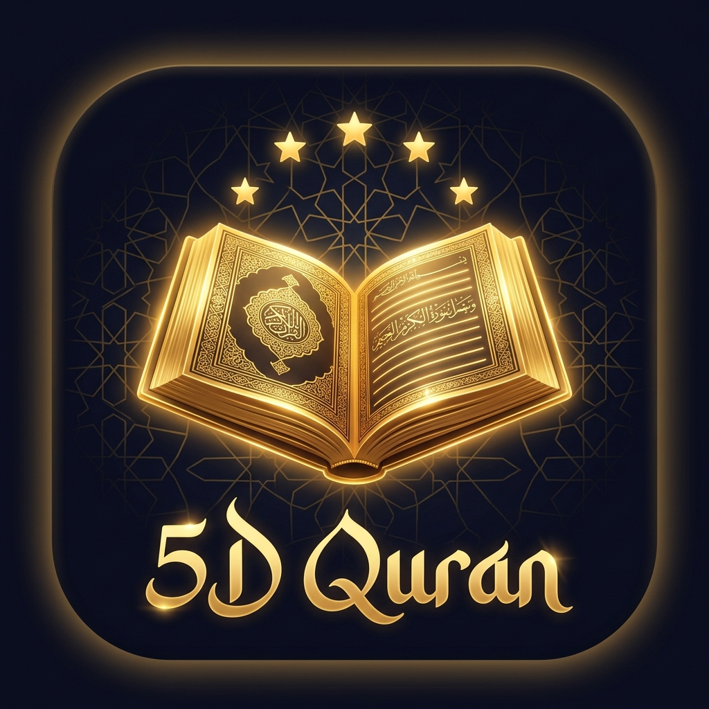

# 5D Quran (v1.0.1)

<p align="center">
  
</p>

<p align="center">
  <b>5 Dimensi Interaksi dengan Al-Qur'an</b><br/>
  <i>Dibaca · Didengar · Dihafal · Ditulis · Dipelajari</i>
</p>

<p align="center">
  
  
  
  
</p>

---

## 🌟 Tentang 5D Quran

**5D Quran** adalah aplikasi Al-Qur'an digital generasi baru yang dirancang untuk memberikan pengalaman interaksi mendalam bersama Al-Qur'an melalui **5 Dimensi Utama**:

```
                  ┌───────────────────────┐
                  │       5D QURAN        │
                  └───────────┬───────────┘
         ┌────────────┬───────┴───────┬────────────┐
         ▼            ▼               ▼            ▼
     📖 DIBACA    🎧 DIDENGAR    🧠 DIHAFAL   ✍️ DITULIS
                      └───────┬───────┘
                              ▼
                        📚 DIPELAJARI
```

### 1. 📖 Dibaca (Mushaf Al-Qur'an)
- Mushaf lengkap 114 Surah (30 Juz) dengan teks Uthmani & IndoPak beresolusi tinggi offline.
- Perataan teks Arab rapat kanan (*Right-to-Left / RTL alignment*) yang rapi dan konsisten pada setiap baris ayat.
- Pilihan font mushaf (Amiri, Uthmani, IndoPak) serta pengaturan ukuran font yang fleksibel.
- Mode baca Arab saja atau disertai terjemahan resmi Kementerian Agama RI.

### 2. 🎧 Didengar (Murottal Audio Per Ayat)
- Audio murottal per ayat dan per surah dari qari-qari terkemuka internasional:
  - *Mishari Rashid Alafasy*
  - *Saad Al-Ghamadi*
  - *Abdurrahman As-Sudais*
  - *Muhammad Siddiq Al-Minshawi*
  - *Mahmoud Khalil Al-Husary*
- Fitur **Karaoke Highlight**: penyorotan teks kata demi kata secara real-time mengikuti bacaan audio qari.
- Kontrol pemutar audio mengambang (*floating audio player*) yang mudah diakses.

### 3. 🧠 Dihafal (Setoran Suara & Voice Recognition Native)
- Setoran hafalan ayat mandiri menggunakan pengenal suara (*Android SpeechRecognizer*) berkecepatan tinggi.
- Real-time live speech detection: teks Arab yang Anda ucapkan langsung tampil dan mengikuti bacaan.
- **Pemeriksaan Akurasi Cerdas**: Menghitung persentase kecocokan hafalan serta menampilkan koreksi kata demi kata (*Word-by-word diff*):
  - Hijau: Kata benar dan cocok
  - Merah: Kata yang keliru atau terlewat
- Perekaman audio lokal untuk membandingkan bacaan pengguna langsung dengan suara qari standar.

### 4. ✍️ Ditulis (Latihan Mengetik Bahasa Arab)
- Mengetik ayat-ayat Al-Qur'an secara langsung menggunakan keyboard bahasa Arab.
- Pilihan mode latihan:
  - *Dengan Contoh*: Menampilkan teks target ayat sebagai panduan mengetik.
  - *Tanpa Contoh*: Menyembunyikan teks ayat untuk menguji ketajaman ingatan dan ejaan hafalan Anda.
- Pemeriksaan otomatis kesesuaian pengetikan dengan laporan skor akurasi dan analisis kata.
- Deteksi otomatis keyboard bahasa Arab pada perangkat pengguna.

### 5. 📚 Dipelajari & Tadabur
- **Kosakata Per Kata (*Mufradat*)**: Menampilkan arti dan cara baca kata demi kata dari setiap ayat.
- **Tafsir Ibnu Katsir**: Kajian tafsir mendalam berbahasa Indonesia untuk setiap ayat, dapat diunduh untuk dibaca offline.
- **Hadis Terkait & Asbabun Nuzul**: Menghubungkan ayat dengan riwayat hadis sahih dan latar belakang turunnya ayat.
- **Fitur Bagikan (*Share*)**:
  - 📤 Bagikan teks ayat dan terjemahan.
  - 📤 Bagikan mufradat kata per kata.
  - 📤 Bagikan intisari Tafsir Ibnu Katsir.
  - 📤 Bagikan rangkuman Tadabur lengkap.

---

## 💬 Fitur Pelaporan & Pusat Masukan Pengembang (v1.0.1)

Aplikasi ini dilengkapi dengan **Pusat Chat & Bantuan**:
- Pengguna dapat mengirimkan laporan kendala/kesalahan (*bug report*) atau mengusulkan ide fitur baru secara langsung dari aplikasi.
- **Privasi Terjamin**: Alamat email pengembang diproses di sisi server dan tidak diekspos di antarmuka pengguna.
- Balasan dari pengembang akan langsung terkirim dan muncul sebagai gelembung chat balasan resmi di dalam aplikasi pengguna secara live.

---

## 📡 Sumber Data & Referensi

- **Teks Al-Qur'an & Metadata**: AlQuran.cloud API
- **Audio Murottal**: EveryAyah.com & QuranicAudio
- **Tafsir Ibnu Katsir (Bahasa Indonesia)**: Tafsirq & e-Quran Database
- **Terjemahan Bahasa Indonesia**: Kementerian Agama Republik Indonesia (Kemenag RI)

---

## 🚀 Kompilasi & Menjalankan Proyek

### Prasyarat
- **Android SDK** (API Level 23 s/d 34)
- **Java JDK 17**
- **Docker** (Opsional, untuk kompilasi APK otomatis di container `t2p-android-builder`)

### Build APK Android
```bash
# Menjalankan build script otomatis
build-android.bat
```
Atau menggunakan Gradle wrapper di folder `android/`:
```bash
cd android
./gradlew assembleDebug
```
File APK biner yang dihasilkan: `5D-Quran-v1.0.1-Native.apk`.

### Install Langsung ke HP Android (USB/ADB)
```bash
install-ke-hp.bat
```

### Jalankan Distribusi APK via Jaringan Lokal (WiFi)
```bash
python share-apk.py
```

---

## 🤝 Kontribusi & Pengembangan Lanjutan

> **Pemberitahuan:**  
> **Silakan project ini untuk terus di-update dan dikembangkan lebih lanjut.**  
> Siapa pun dipersilakan untuk melanjutkan pengembangan, menambahkan fitur-fitur baru yang bermanfaat bagi umat, memperbaiki kendala, serta memperkaya konten tadabur dan pembelajaran Al-Qur'an di aplikasi ini.

---

## 🤲 Doa & Dedikasi

<p align="center">
  بِسْمِ اللَّهِ الرَّحْمَٰنِ الرَّحِيمِ<br/>
  <b>Semoga aplikasi dan proyek ini menjadi amal jariyah yang pahalanya terus mengalir bagi Ari Adrianto dan Keluarga.</b><br/>
  <i>Aamiin Ya Rabbal 'Alamin.</i>
</p>

---

<p align="center">
  Dibuat dengan penuh cinta dan takzim untuk Al-Qur'an Al-Karim.<br/>
  <b>5D Quran © 2026</b>
</p>
